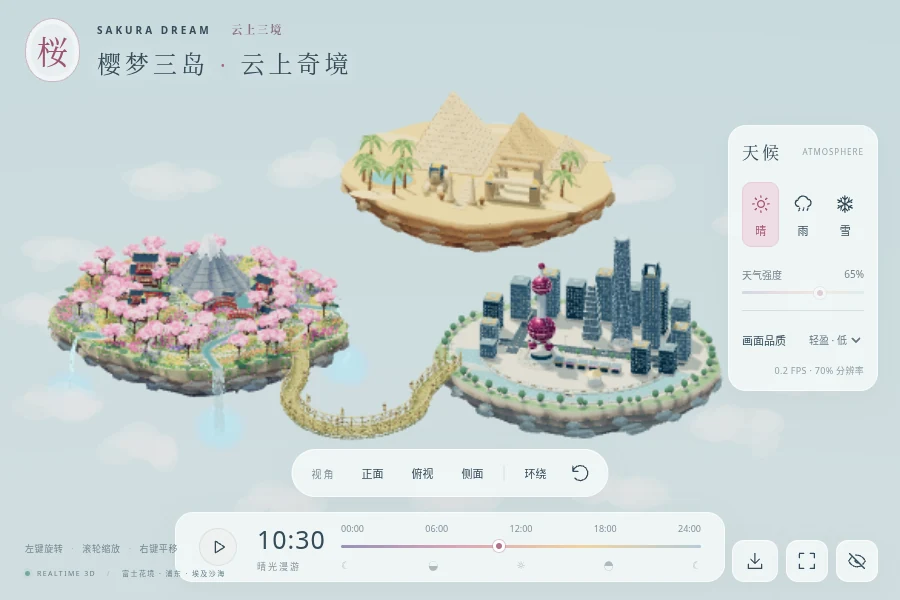

# 樱梦三岛 · 云上奇境

**Sakura Dream — Three Islands 3.5** 是一个可实时探索、可完全离线运行的原创 3D 微缩世界。富士山樱花花境、上海浦东天际线和埃及沙漠古迹三座悬浮岛坐落在云海中，富士与浦东之间有一条 U 型竹桥。可旋转、缩放和平移浏览，同时欣赏动态流水、云海和昼夜变化。

项目使用 Three.js、TypeScript、WebGL 与 GLSL 程序化生成全部模型、材质和动画。没有远程模型、贴图、字体、音频、CDN、付费 API 或游戏专有资产。用户提供的图片仅用于构图与风格研究，没有被打包为背景或贴图。



## 立即运行

开发环境需要 Node.js 22.12+ 或 24+：

```sh
npm ci
npm run dev
```

验证正式构建与页面内下载功能：

```sh
npm test
npm run build
npm run preview
```

构建后的在线网站位于 `dist/`，完整交付文件位于 `release/`。仓库中的 [downloads/v3.1.0](downloads/v3.1.0) 保留历史版本快照；当前 3.5 版请构建后从 `release/` 获取。

## 场景内容

- 富士与浦东两座大小相近的浮岛，中心间距 36 单位；另在后方新增埃及沙漠岛，三岛均具有分层悬空岩体。
- 上海浦东微缩岛：东方明珠的双球观景层与天线、上海中心的扭转塔身、环球金融中心的开口轮廓、金茂大厦的阶梯塔冠，以及高低错落的街区、滨水步道与夜间窗灯。
- 埃及岛包含金字塔、沙丘、沙色石层、古迹与绿洲。
- U 型竹桥横跨富士与浦东两岛，包含竹板桥面、双侧扶手、竹节、绳结与灯笼；桥头分别与两岛地表衔接。
- 扩大天空、云层、天气和阴影覆盖范围；四个镜头完整容纳三岛和竹桥，支持更大的平移与近景缩放范围。
- 随岛屿扩建加宽、增高，具有连续山脊、六层岩质台地、分叉雪线与凹陷火山口的富士山；中后方青蓝湖泊、小岛与蜿蜒溪流。
- 前景和两侧为连续花毯，包含郁金香、薰衣草、波斯菊、黄色小菊与幻想花卉。
- 3 座主要神社 / 塔楼、6 座小屋 / 凉亭、2 座鸟居、2 座木拱桥、木平台、栏杆、石灯笼和纵横石板路。
- 47 棵不同大小的樱花树；每棵包含分枝、分层花冠与独立花瓣簇。
- 三条与上游水道逐点衔接的瀑布，水面自然翻折、流纹和水滴随落差加速；按河道方向流动的细波、焦散、岸边泡沫、雨滴涟漪、加速坠落的离散水滴和下方水雾粒子；岛底采用错台岩层、暗色断层、宽岩块、苔藓和垂藤，减少均匀长尖石。
- Toon / NPR 明暗分区、手绘颗粒、柔和 Bloom、昼夜星空、花海风动与缓慢流动、浮动起伏的云层。樱花花瓣为带缺口的弯曲立体实例，从树冠飘出、三轴翻转，落地后渐隐。

## 操作

| 控制 | 作用 |
| --- | --- |
| 鼠标左键拖动 | 平滑旋转视角 |
| 滚轮 | 缩放，带合理限制 |
| 鼠标右键拖动 | 平移，目标限制在岛屿范围内 |
| 正面 / 俯视 / 侧面 | 切换三个参考视角 |
| 复位 / `R` | 回到斜俯视英雄镜头 |
| 环绕 | 开启或暂停慢速自动环绕 |
| 时间滑块 | 连续选择 00:00—24:00；手动拖动会暂停自动播放 |
| 播放 / 空格 | 约四分钟循环一天 |
| 晴 / 雨 / 雪 | 独立于时间切换天气；雨雪强度分别记忆 |
| 画质 | 低 / 中 / 高三档实例密度、天气粒子、阴影、Bloom 与分辨率上限 |
| 隐藏界面 / `H` | 进入或离开纯净观赏模式 |
| 全屏 | 进入或退出浏览器全屏 |
| 收藏三岛 | 下载独立 HTML、Windows 离线包或可编辑源码 |

低、中、高画质分别显示约 6,500 / 11,000 / 16,500 株立体花卉，三岛天气粒子上限为 2,550 / 4,800 / 7,800；晴天立体落樱预算为 160 / 300 / 460 片。花卉始终使用 `InstancedMesh`；建筑、道路、崖壁和藤蔓按材质合并。渲染分辨率会根据最近帧率在用户选定档位内自适应调整，最低降至 65%。

## Windows 离线版

`npm run build` 生成：

| 文件 | 用途 |
| --- | --- |
| `release/sakura-dream-offline.html` | 资源完整内嵌的独立网页，优先双击打开 |
| `release/sakura-dream-offline.zip` | 独立网页、中文说明、许可证和 Windows 本地启动器 |
| `release/sakura-dream-complete.zip` | 完整源码与离线版的总交付包 |
| `release/sakura-dream-source.zip` | 可编辑源代码和固定依赖锁文件 |
| `release/THIRD_PARTY_LICENSES.txt` | 第三方依赖许可证原文 |

普通用户不需要安装 Node.js、Python 或专业 3D 软件。解压离线 ZIP 后，先双击 `index.html`。如果浏览器组织策略限制 `file://`，双击 `start-local.cmd`；它只使用 Windows 内置 PowerShell，在随机空闲端口监听 `127.0.0.1`，不会联网、修改系统执行策略或请求管理员权限。关闭命令窗口即可停止。

离线 HTML 内嵌全部场景代码、Shader、UI、许可证和项目源码归档。断网状态下仍可拖动时间、切换雨雪、操作镜头，并再次下载离线包与源码。

## GitHub Pages

仓库包含 [.github/workflows/pages.yml](.github/workflows/pages.yml)。在 GitHub 仓库 **Settings → Pages → Source** 选择 **GitHub Actions**；推送到 `main` 或手动运行工作流后，会执行核心测试、构建 `dist/` 并部署静态网站，同时上传完整发布包制品。

Vite 使用相对 `base`，可部署到 GitHub Pages 仓库子路径。其他静态托管的构建命令为 `npm ci && npm run build`，输出目录为 `dist`；不需要后端、数据库、环境变量或密钥。

## 验证

```sh
npm test
npm run build
npm run test:browser
```

核心测试检查连续昼夜、时间端点、扩大三分之一后的岛屿边界、岩石厚度、富士山比例、可种植覆盖率、确定性分布、实例花卉、47 棵树和完整建筑数量。

浏览器测试使用真实 WebGL 页面检查英雄构图、昼夜、雨雪与地表响应、跨午夜播放、四个镜头的完整新岸线、手机竖屏、落樱与水面动画、鼠标旋转 / 缩放 / 平移、慢速环绕、三档画质、全屏、隐藏 UI、1920 × 1080 尺寸、实际下载文件内容、断网单文件运行、离线雨雪与镜头，以及 WebGL 上下文丢失提示。报告和截图写入 `test-results/`；本版结果见 [V3.5 验证记录](docs/VALIDATION-3.5.md)，此前记录保留在 [V3.4](docs/VALIDATION-3.4.md)、[V3.3](docs/VALIDATION-3.3.md) 和 [V3.2](docs/VALIDATION.md)。

云环境的 Chromium 管理策略禁止 `file://` 导航，所以自动化在全禁网浏览器上下文的 `about:blank` 中加载完全相同的独立 HTML，并确认没有任何 HTTP 请求。实际 Windows 双击和 `start-local.cmd` 仍需要 Windows 实机复核。

云环境只有 SwiftShader 软件 WebGL，性能采样见验证记录，不能代表真实独立显卡。页面已经采用低绘制调用、实例化、合并几何、花卉近景细节切换、自适应像素比和按需阴影更新；真实 Windows GPU 性能仍需设备测试。

## 源码结构

```text
src/
  main.ts                        # 场景装配、状态、后期处理、渲染循环与释放
  world/
    Island.ts                    # 扩大后的地表、岩石底座、石路、悬藤
    Mountain.ts                  # 富士山脊与程序雪线
    Shanghai.ts                  # 浦东岛、东方明珠、摩天楼、滨水街区与夜景
    BambooBridge.ts              # 两岛间的 U 型竹桥、扶手和灯笼
    Egypt.ts                     # 埃及沙漠岛、金字塔、古迹和绿洲
    Vegetation.ts                # 实例花海、风动、樱花枝干与花簇
    Architecture.ts              # 神社、木屋、瓦顶、鸟居、桥、灯笼
    Water.ts / WaterReflection.ts # 共享平面倒影、溪流、三条瀑布与水雾
    Environment.ts               # 天空、云层、灯光与雾
    Weather.ts                   # 世界空间雨、雪与樱花花瓣
    materials.ts / layout.ts     # NPR 材质、合批、统一空间布局
  controllers/
    TimeController.ts            # 24 小时连续插值
    CameraController.ts          # 正交微缩镜头、取景与 OrbitControls
    Downloads.ts                 # 独立 HTML、离线 ZIP 与源码下载
  ui/UI.ts / style.css           # 桌面幻想风格控制界面
scripts/package.mjs              # 单文件嵌入、许可证和发布包
scripts/start-local.cmd          # 无额外依赖的 Windows 本地服务
tests/                           # 核心测试与浏览器端到端测试
```

## 技术边界与许可证

- 水面和瀑布为实时 Shader 与几何动画，不是流体模拟；雨天增加波纹和湿润着色，雪天改变朝上表面颜色，不执行逐帧物理积雪。
- 中、高画质共用一张实时平面倒影纹理，分别以最高约 6 / 12 次每秒更新，并保留至少一帧复用；倒影绘制山体、建筑和樱树等主要轮廓，省略微小花卉实例，低画质使用天空反射配色。水面结合 Fresnel 反射与方向性细波，没有光线追踪或真实流体模拟。
- 场景为程序化原创艺术近似，不是富士山、上海地标、神社或参考图片的测绘复刻。
- 项目源码为 [MIT](LICENSE)。Three.js、fflate、Vite、Playwright 等依赖保留各自许可证。
